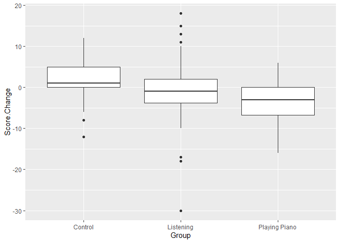
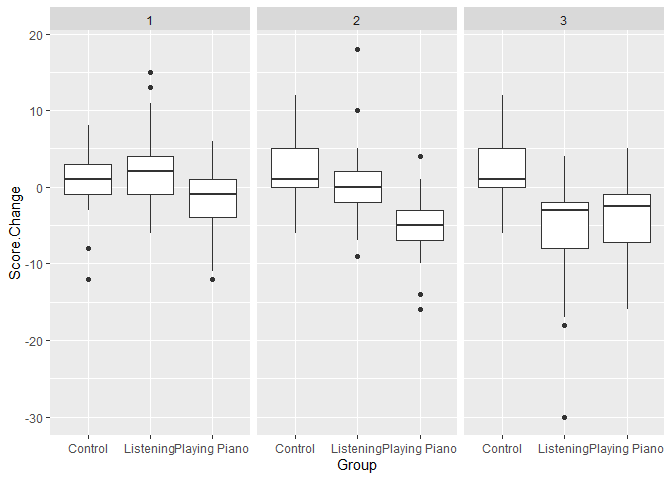
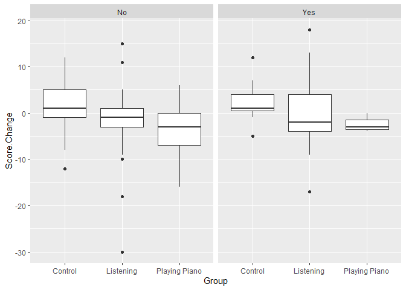
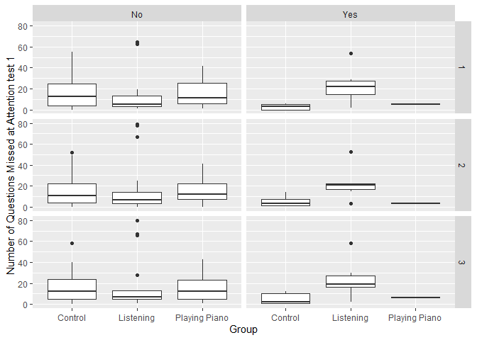
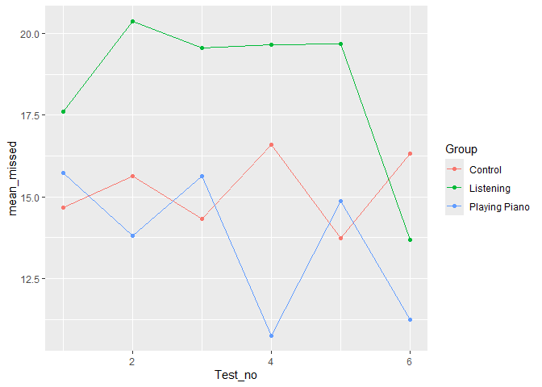
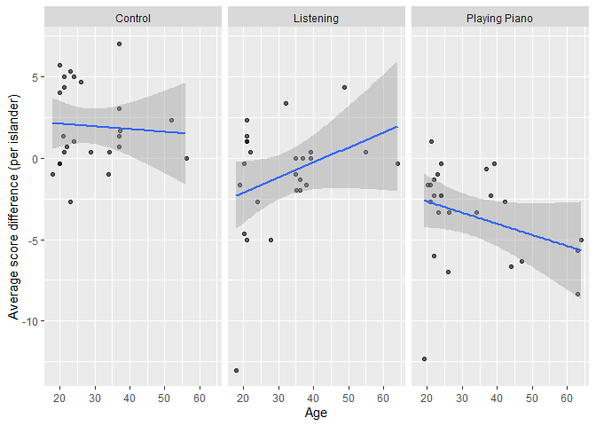
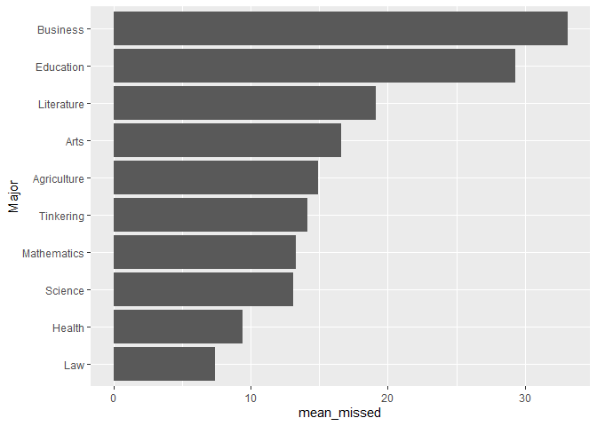

The Islands, Part 2: Study
================
Nerissa Theisen
2026-11-09

- [Grading Rubric](#grading-rubric)
  - [Individual](#individual)
  - [Submission](#submission)
- [Setup](#setup)
  - [**q1** Planning a study (TEAMWORK)](#q1-planning-a-study-teamwork)
  - [**q2** EDA](#q2-eda)
  - [**q3** Key Analyses](#q3-key-analyses)
  - [**q4** Answers](#q4-answers)

*Purpose*: This is part 2 of 2. In part 1 you *planed* your statistical
project, particularly your data collection. In this part you will give
updates on your plan, and report your findings.

This challenge is deliberately shorter so you have time to collect and
analyze your data.

*Important note*: While we expect that you did your data collection with
your team, you need to complete your own individual report for c10.

<!-- include-rubric -->

# Grading Rubric

<!-- -------------------------------------------------- -->

Unlike exercises, **challenges will be graded**. The following rubrics
define how you will be graded, both on an individual and team basis.

## Individual

<!-- ------------------------- -->

| Category | Needs Improvement | Satisfactory |
|----|----|----|
| Effort | Some task **q**’s left unattempted | All task **q**’s attempted |
| Observed | Did not document observations, or observations incorrect | Documented correct observations based on analysis |
| Supported | Some observations not clearly supported by analysis | All observations clearly supported by analysis (table, graph, etc.) |
| Assessed | Observations include claims not supported by the data, or reflect a level of certainty not warranted by the data | Observations are appropriately qualified by the quality & relevance of the data and (in)conclusiveness of the support |
| Specified | Uses the phrase “more data are necessary” without clarification | Any statement that “more data are necessary” specifies which *specific* data are needed to answer what *specific* question |
| Code Styled | Violations of the [style guide](https://style.tidyverse.org/) hinder readability | Code sufficiently close to the [style guide](https://style.tidyverse.org/) |

## Submission

<!-- ------------------------- -->

Make sure to commit both the challenge report (`report.md` file) and
supporting files (`report_files/` folder) when you are done! Then submit
a link to Canvas. **Your Challenge submission is not complete without
all files uploaded to GitHub.**

# Setup

<!-- ----------------------------------------------------------------------- -->

``` r
library(tidyverse)
```

    ## ── Attaching core tidyverse packages ──────────────────────── tidyverse 2.0.0 ──
    ## ✔ dplyr     1.2.1     ✔ readr     2.2.0
    ## ✔ forcats   1.0.1     ✔ stringr   1.6.0
    ## ✔ ggplot2   4.0.3     ✔ tibble    3.3.1
    ## ✔ lubridate 1.9.5     ✔ tidyr     1.3.2
    ## ✔ purrr     1.2.2     
    ## ── Conflicts ────────────────────────────────────────── tidyverse_conflicts() ──
    ## ✖ dplyr::filter() masks stats::filter()
    ## ✖ dplyr::lag()    masks stats::lag()
    ## ℹ Use the conflicted package (<http://conflicted.r-lib.org/>) to force all conflicts to become errors

``` r
library(rsample)

# TODO: Include any other packages you need
```

### **q1** Planning a study (TEAMWORK)

While you provided this plan in c08 (Part 1), please include your plan
here. In particular, describe how you updated your plan in response to
feedback.

#### Population

- (What population are you going to study?)
  - We are going to study students at Arcadia University, across all
    majors, that do not play piano.

#### Quantity of interest

- (Write your quantity of interest here)
  - Our quantity of interest is results from the attention test.

#### Covariates

- The type of music - we are going to be making people listen to
  classical music.
- Majors are a covariate, but we are going to be studying students from
  every major and selecting randomly.
- Age - we found that there was a wide range of ages in the university,
  so we tracked it to see if it had an effect on scores.
- Whether people usually listen to classical music or not - we don’t
  expect this to effect anything, but we will be tracking this just in
  case.

#### Observation or experiment?

The Islands allows you to ask islanders to complete tasks. If you just
take measurements on your participants, then it’s an *observational
study*. But if you also introduce something that’s meant to change the
outcome of a measurement (e.g., drinking coffee before taking a test),
that’s called an *experimental study*. You need to decide whether your
study is observational or experimental.

- This is going to be an experimental study. We are going to make people
  listen to music or play an instrument before taking an attention test
  to see the effect of the actions.

#### Question / Hypothesis

- Does actively playing music or passively listening to music improve
  attention span? If so, does one improve it more than the other?
- We have a control group to ensure that scores don’t just improve
  because people are retaking the test. We hypothesized that actively
  playing or listening to music will improve attention span and that
  both will have a relatively similar effect.

#### Sampling plan

- (What steps will you take to collect the data?)
  - Be specific. For instance, if you’re going to collect a random
    sample, how will you enumerate all of the things to be sampled?
  - Write a protocol. Document step-by-step instructions that your team
    will follow. That way, you can feasibly split up data collection
    among the whole team, while making sure each team member doesn’t
    make ad hoc decisions that introduce bias into your results.

1.  Copy a list of students at Arcadia University onto a Google Document
    and make the list numbered.
2.  Use a random number generator to select 75 numbers. Find the
    students corresponding with those numbers on the list.
3.  Ask each student what instruments they play.
4.  If the student says they play piano, generate a new random number
    and find a new person. Ask them the same thing and ensure they do
    not play piano. Make sure to keep track of the numbers of students
    who have been removed from the study so we don’t go back to them.
5.  Once we have a desirable set of people, split the students into 3
    groups of 25.
6.  Ask each person if they listen to classical music or not. Record
    their answer to this question, their age, and their major.
7.  Give the first group an attention test. Record their score and wait
    10 minutes before giving them an attention test again. Record the
    new score.
8.  Give the second group an attention test. Record their score and make
    them listen to classical music for 10 minutes before giving them an
    attention test again. Record the new score.
9.  Give the third group an attention test. Record their score and make
    them play piano for 10 minutes before giving them an attention test
    again. Record the new score.
10. Repeat steps 7-9 over two more days.

- (How will you ensure the data is representative of your chosen
  population?)
  - We we will take a random sample of the students that does not depend
    on major, so that the group is representative of the whole
    university. We will ask everyone what instruments they play to
    ensure no one we’re studying plays piano.
- (For experiments only: How will you ensure any effects you observe are
  due to the treatment, and not due to other factors?)
  - We will take an attention test six times across three different
    days. This gives us more data that can combat differences in
    attention that may be due to day-to-day factors like mood or
    weather.
- (How will you choose your sample size?)
  - We chose a sample size of 25 per group because it would be a
    reasonable amount of data to collect, while also giving us fairly
    accurate results. With a sample group of 25, a target power of 75%,
    and a significance level of 10%, we have a minimum detectable
    Cohen’s f of about 0.3, which will allow us to find medium-sized
    effects.

Based on the feedback we received, we made sure to check our sample size
in terms of the accuracy it could achieve, and we confirmed it would
give us a result we were comfortable with. We also made our sampling
plan more specific so it is clear that we do have a control group.

### **q2** EDA

Conduct an EDA on your data. Add as many code chunks as you need. Ensure
your EDA gives enough context of the data for us to understand what
comes next in this report.

``` r
filename = "C:/Users/polar/OneDrive/Documents/School/2026-2027 1st Semester/Data Science/RStudio/data-science-curriculum-build/Data-Science-2026/challenges/data/c10_data.csv"

data <- read.csv(filename, blank.lines.skip = TRUE)
```

``` r
data %>%
  summary()
```

    ##      Number             Name           Major     Listens.to.Classical.Music.
    ##  Min.   : 1.00   Length   :300   Length   :300   Length   :300              
    ##  1st Qu.:25.75   N.unique : 74   N.unique : 10   N.unique :  2              
    ##  Median :38.00   N.blank  :  0   N.blank  :  0   N.blank  :  0              
    ##  Mean   :38.00   Min.nchar:  8   Min.nchar:  3   Min.nchar:  2              
    ##  3rd Qu.:50.25   Max.nchar: 19   Max.nchar: 11   Max.nchar:  3              
    ##  Max.   :75.00                                                              
    ##                                                                             
    ##       Age        Number.Missed..Attention.Test.1.
    ##  Min.   :18.00   Min.   : 0.00                   
    ##  1st Qu.:21.00   1st Qu.: 4.00                   
    ##  Median :26.00   Median :10.00                   
    ##  Mean   :30.95   Mean   :16.89                   
    ##  3rd Qu.:37.00   3rd Qu.:22.00                   
    ##  Max.   :64.00   Max.   :80.00                   
    ##                  NAs    :1                       
    ##  Number.Missed..Attention.Test.2.  Score.Change            Group    
    ##  Min.   : 0.00                    Min.   :-30.0000   Length   :300  
    ##  1st Qu.: 4.00                    1st Qu.: -4.0000   N.unique :  3  
    ##  Median : 8.00                    Median : -1.0000   N.blank  :  0  
    ##  Mean   :15.99                    Mean   : -0.8997   Min.nchar:  7  
    ##  3rd Qu.:23.00                    3rd Qu.:  2.0000   Max.nchar: 13  
    ##  Max.   :76.00                    Max.   : 18.0000                  
    ##  NAs    :1                        NAs    :1                         
    ##       Day   
    ##  Min.   :1  
    ##  1st Qu.:1  
    ##  Median :2  
    ##  Mean   :2  
    ##  3rd Qu.:3  
    ##  Max.   :3  
    ## 

``` r
data %>%
  glimpse()
```

    ## Rows: 300
    ## Columns: 10
    ## $ Number                           <int> 51, 52, 53, 54, 55, 56, 57, 58, 59, 6…
    ## $ Name                             <chr> "Rin Yamada", "Ava Kato", "Laurence C…
    ## $ Major                            <chr> "Mathematics", "Education", "Agricult…
    ## $ Listens.to.Classical.Music.      <chr> "No", "No", "Yes", "No", "No", "No", …
    ## $ Age                              <int> 24, 20, 21, 18, 20, 37, 37, 34, 20, 2…
    ## $ Number.Missed..Attention.Test.1. <int> 11, 7, 3, 55, 4, 7, 49, 32, 20, 2, 0,…
    ## $ Number.Missed..Attention.Test.2. <int> 16, 5, 3, 43, 6, 10, 54, 24, 23, 4, 2…
    ## $ Score.Change                     <int> 5, -2, 0, -12, 2, 3, 5, -8, 3, 2, 2, …
    ## $ Group                            <chr> "Control", "Control", "Control", "Con…
    ## $ Day                              <int> 1, 1, 1, 1, 1, 1, 1, 1, 1, 1, 1, 1, 1…

``` r
data %>%
  ggplot(aes(x = Group, y = Score.Change)) +
  geom_boxplot()
```

    ## Warning: Removed 1 row containing non-finite outside the scale range
    ## (`stat_boxplot()`).

<!-- -->

``` r
data %>%
  ggplot(aes(x = Group, y = Score.Change)) + 
  geom_boxplot() + 
  facet_wrap(.~ Day)
```

    ## Warning: Removed 1 row containing non-finite outside the scale range
    ## (`stat_boxplot()`).

<!-- -->

``` r
data %>%
  ggplot(aes(x = Group, y = Score.Change)) +
  geom_boxplot() +
  facet_grid(.~ Listens.to.Classical.Music.)
```

    ## Warning: Removed 1 row containing non-finite outside the scale range
    ## (`stat_boxplot()`).

<!-- -->

``` r
data %>%
   filter(!is.na(`Number.Missed..Attention.Test.1.`)) %>%
   ggplot(aes(x = Group, y = `Number.Missed..Attention.Test.1.`)) +
   geom_boxplot() +
   facet_grid(Day ~ `Listens.to.Classical.Music.`) +
   labs(
     x = "Group",
     y = "Number of Questions Missed at Attention test 1"
   ) 
```

<!-- -->

``` r
data <- data %>%
  group_by(Major) %>%
  pivot_longer(
    names_to = "Attention Test Number",
    values_to = "Number Missed",
    cols = contains("Attention")
    ) %>%
  mutate(
    `Attention Test Number` = str_extract(`Attention Test Number`, "\\d") %>%
      as.integer()
    )

mean_by_test <- data %>%
  group_by(`Attention Test Number`, Day, Group) %>%
  summarize(
    mean_missed = mean(`Number Missed`, na.rm = TRUE)
    ) %>%
  ungroup() %>%
  mutate(
    Test_no = (Day - 1) * 2 + `Attention Test Number`,
    ) %>%
  arrange(Group, Test_no)
```

    ## `summarise()` has regrouped the output.
    ## ℹ Summaries were computed grouped by Attention Test Number, Day, and Group.
    ## ℹ Output is grouped by Attention Test Number and Day.
    ## ℹ Use `summarise(.groups = "drop_last")` to silence this message.
    ## ℹ Use `summarise(.by = c(Attention Test Number, Day, Group))` for per-operation
    ##   grouping (`?dplyr::dplyr_by`) instead.

``` r
mean_by_test
```

    ## # A tibble: 18 × 5
    ##    `Attention Test Number`   Day Group         mean_missed Test_no
    ##                      <int> <int> <chr>               <dbl>   <dbl>
    ##  1                       1     1 Control              14.7       1
    ##  2                       2     1 Control              15.6       2
    ##  3                       1     2 Control              14.3       3
    ##  4                       2     2 Control              16.6       4
    ##  5                       1     3 Control              13.7       5
    ##  6                       2     3 Control              16.3       6
    ##  7                       1     1 Listening            17.6       1
    ##  8                       2     1 Listening            20.4       2
    ##  9                       1     2 Listening            19.6       3
    ## 10                       2     2 Listening            19.6       4
    ## 11                       1     3 Listening            19.7       5
    ## 12                       2     3 Listening            13.7       6
    ## 13                       1     1 Playing Piano        15.7       1
    ## 14                       2     1 Playing Piano        13.8       2
    ## 15                       1     2 Playing Piano        15.6       3
    ## 16                       2     2 Playing Piano        10.8       4
    ## 17                       1     3 Playing Piano        14.9       5
    ## 18                       2     3 Playing Piano        11.2       6

``` r
mean_by_test %>%
  ggplot(aes(Test_no, `mean_missed`, color = Group)) +
  geom_line() +
  geom_point()
```

<!-- -->

``` r
data2 <- read_csv("C:/Users/polar/OneDrive/Documents/School/2026-2027 1st Semester/Data Science/RStudio/data-science-curriculum-build/Data-Science-2026/challenges/data/c10_data.csv") %>%
  rename(
    number = 1,
    name = 2,
    major = 3,
    classical = 4,
    age = 5,
    missed_1 = 6,
    missed_2 = 7,
    score_diff = 8,
    group = 9,
    day = 10
  )
```

    ## Rows: 300 Columns: 10
    ## ── Column specification ────────────────────────────────────────────────────────
    ## Delimiter: ","
    ## chr (4): Name, Major, Listens to Classical Music?, Group
    ## dbl (6): Number, Age, Number Missed (Attention Test 1), Number Missed (Atten...
    ## 
    ## ℹ Use `spec()` to retrieve the full column specification for this data.
    ## ℹ Specify the column types or set `show_col_types = FALSE` to quiet this message.

``` r
df_person <-
  data2 %>%
  filter(!is.na(age), !is.na(score_diff)) %>%
  group_by(number, name, age, group) %>%
  summarize(mean_score_diff = mean(score_diff), .groups = "drop")

df_person %>%
  ggplot(aes(x = age, y = mean_score_diff)) +
  geom_jitter(width = 0.15, height = 0, alpha = 0.6) +
  geom_smooth(method = "lm") +
  facet_wrap(~ group) +
  labs(x = "Age", y = "Average score difference (per islander)")
```

    ## `geom_smooth()` using formula = 'y ~ x'

<!-- -->

``` r
score_by_major <-
  data %>%
  group_by(Major) %>%
  summarize(
    mean_missed = mean(`Number Missed`, na.rm = TRUE),
  ) %>%
  ungroup() %>%
  arrange(mean_missed)

score_by_major %>%
  mutate(
    Major = fct_reorder(Major, mean_missed)
  ) %>%
  ggplot(aes(`mean_missed`, Major)) +
  geom_col()
```

<!-- -->

### **q3** Key Analyses

Present the key analyses that support your questions / hypotheses. This
could include summary statistics (e.g., a proportion of Islanders),
grouped summary statistics (e.g., a proportion for group A, and for
group B), or visualizations (e.g., a histogram). This section should be
short, and every analysis should directly relate to q4.

``` r
data %>%
  ggplot(aes(x = Group, y = Score.Change)) +
  geom_boxplot()
```

    ## Warning: Removed 2 rows containing non-finite outside the scale range
    ## (`stat_boxplot()`).

<!-- -->

``` r
mean_by_test <- data %>%
  group_by(`Attention Test Number`, Day, Group) %>%
  summarize(
    mean_missed = mean(`Number Missed`, na.rm = TRUE)
    ) %>%
  ungroup() %>%
  mutate(
    Test_no = (Day - 1) * 2 + `Attention Test Number`,
    ) %>%
  arrange(Group, Test_no)
```

    ## `summarise()` has regrouped the output.
    ## ℹ Summaries were computed grouped by Attention Test Number, Day, and Group.
    ## ℹ Output is grouped by Attention Test Number and Day.
    ## ℹ Use `summarise(.groups = "drop_last")` to silence this message.
    ## ℹ Use `summarise(.by = c(Attention Test Number, Day, Group))` for per-operation
    ##   grouping (`?dplyr::dplyr_by`) instead.

``` r
mean_by_test %>%
  ggplot(aes(Test_no, `mean_missed`, color = Group)) +
  geom_line() +
  geom_point()
```

<!-- -->

``` r
data2 <- read_csv("C:/Users/polar/OneDrive/Documents/School/2026-2027 1st Semester/Data Science/RStudio/data-science-curriculum-build/Data-Science-2026/challenges/data/c10_data.csv") %>%
  rename(
    number = 1,
    name = 2,
    major = 3,
    classical = 4,
    age = 5,
    missed_1 = 6,
    missed_2 = 7,
    score_diff = 8,
    group = 9,
    day = 10
  )
```

    ## Rows: 300 Columns: 10
    ## ── Column specification ────────────────────────────────────────────────────────
    ## Delimiter: ","
    ## chr (4): Name, Major, Listens to Classical Music?, Group
    ## dbl (6): Number, Age, Number Missed (Attention Test 1), Number Missed (Atten...
    ## 
    ## ℹ Use `spec()` to retrieve the full column specification for this data.
    ## ℹ Specify the column types or set `show_col_types = FALSE` to quiet this message.

``` r
df_person <-
  data2 %>%
  filter(!is.na(age), !is.na(score_diff)) %>%
  group_by(number, name, age, group) %>%
  summarize(mean_score_diff = mean(score_diff), .groups = "drop")

df_person %>%
  ggplot(aes(x = age, y = mean_score_diff)) +
  geom_jitter(width = 0.15, height = 0, alpha = 0.6) +
  geom_smooth(method = "lm") +
  facet_wrap(~ group) +
  labs(x = "Age", y = "Average score difference (per islander)")
```

    ## `geom_smooth()` using formula = 'y ~ x'

<!-- -->

### **q4** Answers

Connect your Key Analyses to your questions / hypotheses. What did you
conclude from your study?

We concluded that playing piano and passively listening to music improve
attention span, but playing piano causes a greater improvement. A
positive score change indicates that someone did worse and missed more
markers on an attention test the second time they took it, while a
negative score change indicates that they did better. Over all 3 days,
the median score change of the control group was positive. On the other
hand, both the median score changes for the playing piano and passively
listening to music groups were negative. The playing piano group had the
lowest median, meaning people in that group generally had the greatest
improvements in score out of all the groups.

Interestingly, we also found that the results for the listening to music
group were much different on day 3 than on other days. Our second graph
compares the results to each individual test over all 3 days, and there
is a large dip in scores for the listening group for the second test on
day 3. Before, the scores had been much more consistent across each test
than in the other groups. While the overall trend in our data indicates
that playing piano causes the greatest improvement in attention span, it
should be noted that day-to-day differences such as mood can also play a
role in people’s attention levels.

When initially creating our experiment, we expected that colleges in the
Islands have a similar population to Olin where almost all of the
students are in the 17-22 age range. However, the Islands have a much
more diverse age population at Arcadia University. Since we hadn’t
initially planned on tracking this, we wanted to see if age was
affecting data at all. Fortunately, the plot shows that age doesn’t play
a concrete role in how well students were doing on the attention tests.
As shown by the graph, different groups display different trends when it
comes to age. The listening group shows that participants perform worse
as they get older, but the playing piano group shows that participants
perform better as they get older. This graph also does show that playing
music increases attention. The line we fitted to the piano group is
below the line we fitted to the control group.
