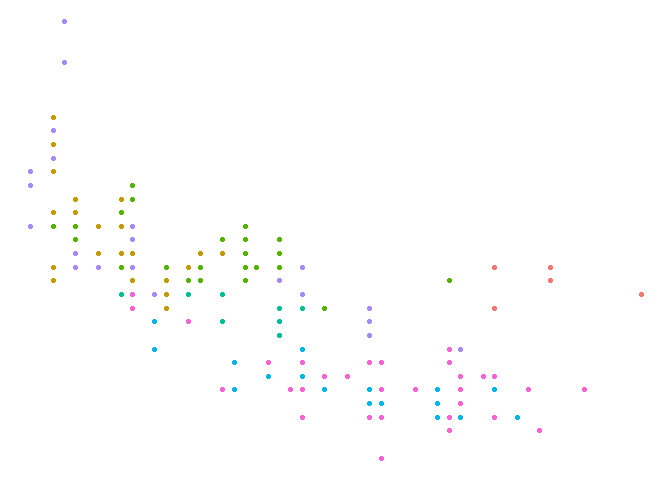
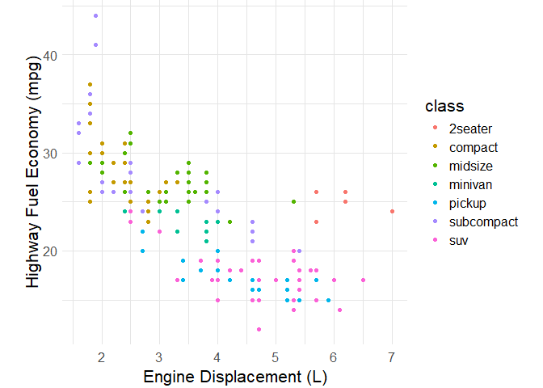
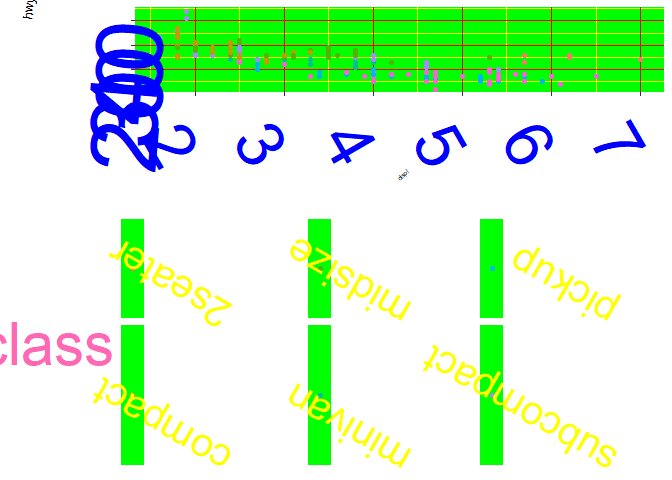

Vis: Themes
================
Zach del Rosario
2020-07-10

# Vis: Themes

*Purpose*: Themes are key for aesthetic purposes; to make really
good-looking graphs, we’ll need to use `theme()`.

*Reading*: [`theme()`
documentation](https://ggplot2.tidyverse.org/reference/theme.html) (Use
as a reference; don’t read the whole thing!)

### **q1** Use `theme_void()` and `guides()` (with an argument) to remove everything in this plot except the points.

``` r
mpg %>%
  ggplot(aes(displ, hwy, color = class)) +
  geom_point() + 
  theme_void() + 
  guides(color = "none")
```

<!-- -->

When I make presentation-quality figures, I often start with the
following stub code:

``` r
## NOTE: No need to edit; feel free to re-use this code!
theme_common <- function() {
  theme_minimal() %+replace%
  theme(
    axis.text.x = element_text(size = 12),
    axis.text.y = element_text(size = 12),
    axis.title.x = element_text(margin = margin(4, 4, 4, 4), size = 16),
    axis.title.y = element_text(margin = margin(4, 4, 4, 4), size = 16, angle = 90),

    legend.title = element_text(size = 16),
    legend.text = element_text(size = 12),

    strip.text.x = element_text(size = 12),
    strip.text.y = element_text(size = 12),

    panel.grid.major = element_line(color = "grey90"),
    panel.grid.minor = element_line(color = "grey90"),

    aspect.ratio = 4 / 4,

    plot.margin = unit(c(t = +0, b = +0, r = +0, l = +0), "cm"),
    plot.title = element_text(size = 18),
    plot.title.position = "plot",
    plot.subtitle = element_text(size = 16),
    plot.caption = element_text(size = 12)
  )
}
```

The `%+replace` magic above allows you to use `theme_common()` within
your own ggplot calls.

### **q2** Use `theme_common()` with the following graph. Document what’s changed by the `theme()` arguments.

``` r
mpg %>%
  ggplot(aes(displ, hwy, color = class)) +
  geom_point() +
  labs(
    x = "Engine Displacement (L)",
    y = "Highway Fuel Economy (mpg)"
  ) +
  theme_common()
```

<!-- -->

**Observations**:

- What changed about the graph when you added `theme_common()`? The axis
  labels and legend became larger when I added `theme_common()`. The
  plot itself also became more squished, although the numbers on the
  axis became larger. The background changed from gray with white lines
  to white with gray lines.

Calling `theme_common()`, along with settings `labs()` and making some
smart choices about geoms and annotations is often all you need to make
a *really high-quality graph*.

### **q3** Make the following plot as *ugly as possible*; the more `theme()` arguments you use, the better!

*Hint*: Use the `theme()` settings from q2 above as a starting point,
and read the documentation for `theme()` to learn how to do more
horrible things to this graph.

``` r
mpg %>%
  ggplot(aes(displ, hwy, color = class)) +
  geom_point() +
  theme(
    axis.text.x = element_text(size = 50, angle = 300, color = "blue"),
    axis.text.y = element_text(size = 70, angle = 85, color = "blue"),
    axis.title.x = element_text(margin = margin(6, 7, 8, 9), size = 5, angle = 40),
    axis.title.y = element_text(margin = margin(1, 2, 3, 4), size = 10, angle = 80),
    
    legend.title = element_text(size = 45, color = "hotpink"),
    legend.text = element_text(size = 30, angle = 150, color = "yellow"),
    legend.position = "bottom",
    
    panel.grid.major = element_line(color = "red"),
    panel.grid.minor = element_line(color = "yellow"),
    panel.background = element_rect(fill = "green")
  )
```

<!-- -->

<!-- include-exit-ticket -->

# Exit Ticket

<!-- -------------------------------------------------- -->

Once you have completed this exercise, make sure to fill out the **exit
ticket survey**, [linked
here](https://docs.google.com/forms/d/e/1FAIpQLSeuq2LFIwWcm05e8-JU84A3irdEL7JkXhMq5Xtoalib36LFHw/viewform?usp=pp_url&entry.693978880=e-vis06-themes-assignment.Rmd).
